# Mermaid記法と対応範囲

ArchMap Mermaid は、公式 Mermaid 12.3.0 のパーサーで解析し、独自のグリッド配置・直交配線・SVGで描画します。Mermaid標準レンダラーと同じ見た目を再現する製品ではありません。対応する構文は以下の範囲です。

## 対応表

○は、表に示す標準構文をArchMapのレンダラーで描画できること、×は未対応を表します。MermaidのCSSや外観をそのまま再現するという意味ではありません。

| 図種 | 対応 | 確認した範囲 |
| --- | --- | --- |
| Flowchart / Graph | ○ | 標準形状・画像、全方向、入れ子subgraphと内部方向、グループへの接続、各端点、不可視線 |
| Sequence | ○ | メッセージ・半矢印・中央接続、参加者タイプ・生成/破棄・リンク、Note、box、活性区間、各フレーム |
| State / Activity | ○ | 複合状態と内部方向、Note、同時状態、開始/終了、choice/fork/join |
| ER | ○ | 属性・キー・型・コメント、別名、多重度、識別/非識別、自己関連 |
| Use Case | ○ | Actor・Use Case、境界、関連・include/extend・汎化、Note |
| Class／クラス図 | × | — |
| Architecture／アーキテクチャ図 | × | `architecture-beta`。システム構成図はFlowchartで作成可能 |
| C4図 | × | — |
| Mindmap／マインドマップ | × | — |
| Block／ブロック図 | × | — |
| Requirement／要求図 | × | — |
| GitGraph | × | — |
| Gantt／ガントチャート | × | — |
| Timeline／タイムライン | ○ | 期間・複数イベント・section。記述順、等間隔の年表 |
| Event Modeling | ○（基本構文） | frame / reset / 明示参照 / data。独立note・GWT・entity定義は未対応 |
| User Journey | × | — |
| Kanban／カンバン | × | — |
| Pie／円グラフ | × | — |
| Quadrant／四象限図 | × | — |
| XY Chart | × | — |
| Sankey／サンキー図 | × | — |
| Packet／パケット図 | × | — |
| Radar／レーダーチャート | × | — |
| Treemap／ツリーマップ | × | — |
| ZenUML | × | — |

業務フロー（BPMN風）・画面遷移・アクティビティ・レイヤー表示はFlowchart／Stateを使ったArchMapのビューです。詳しい対応構文と表示上の制約は、以下の各節を参照してください。

## 図の選び方

| 用途 | Mermaidの宣言 | 補助設定の view |
| --- | --- | --- |
| ER図 | `erDiagram` | 不要 |
| ユースケース図 | `usecase-beta` | 不要 |
| システム概要・変更影響 | `flowchart LR` | `overview` |
| 施策・出来事の年表 | `timeline` | 宣言から判定 |
| 情報の変化 | `eventmodeling` | 宣言から判定 |
| システム構成図 | `flowchart LR` | `system`（既定） |
| レイヤースタック図 | `flowchart TB` | `layers` |
| シーケンス図 | `sequenceDiagram` | 不要 |
| 画面遷移図 | `stateDiagram-v2` または `flowchart LR` | `screens`（状態図では既定） |
| 業務フロー（BPMN風） | `flowchart` / `graph` | `bpmn` |
| アクティビティ図 | `stateDiagram-v2` または `flowchart TB` | `activity` |

図の基本情報・接続はMermaid標準記法で書きます。`%% archmap:` は任意の表示設定で、他のMermaidツールでは通常のコメントとして無視されます。モーダル・画面内操作・配置指定はArchMap Mermaid固有の表示です。

## フローチャート

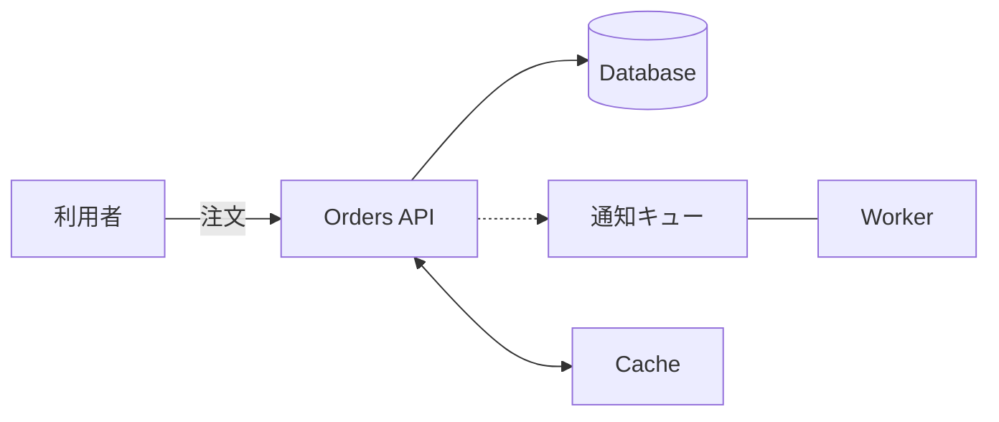

`graph` も利用できます。方向は `LR`、`RL`、`TB`、`TD`、`BT`。四角形・角丸・円・スタジアム・二重円・データベース・ひし形に加え、サブルーチン・六角形・平行四辺形・台形・文書・複数文書・遅延・三角形・クラウドなどの標準形状に対応します。`A@{ shape: doc, label: "仕様書" }` のような標準shape属性も使えます。形状の意味を保ち、色と書体はArchMapに統一します。ノードの暗黙宣言、ラベル付き接続、自己接続、複数接続、実線・破線・太線・双方向・矢印なし・円端点・クロス端点を利用できます。`~~~` は配置に使い、線を描きません。

`A@{ icon: "aws:lambda", label: "Lambda" }` のアイコン属性にも対応します。キーの `aws:` / `gcp:` / `azure:` は内部で `/` に変換します。組み込まれていないアイコンはエラーになります。画像は以下の標準img構文で指定します。サービス名の別名はアイコン一覧で確認してください。

## グループと入れ子

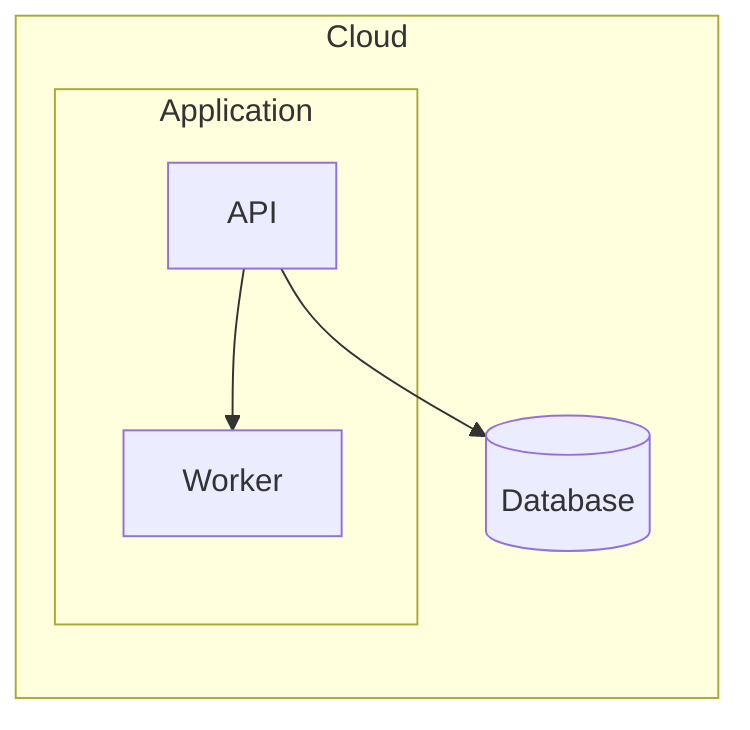

`subgraph` は入れ子にできます。`Group@{ view: collapsed }` は内部を非表示にし、外部との線をグループ枠へ接続します。展開する場合は `view: expanded` を使います。状態図では `state NAME { ... }` がグループになります。グループIDへの接続はグループ枠に接続します（例: `Client --> cloud`、`cloud --> Storage`）。グループ間、入れ子のグループ、内部ノードとの接続にも対応します。グループ内の `direction LR / RL / TB / BT` に対応します。親と子で異なる方向を指定でき、グループを1つの配置単位として扱います。明示的な `at` がある場合は手動配置を優先し、警告を表示します。`layers` ビューでは層の配置を優先します。

## シーケンスと活性区間

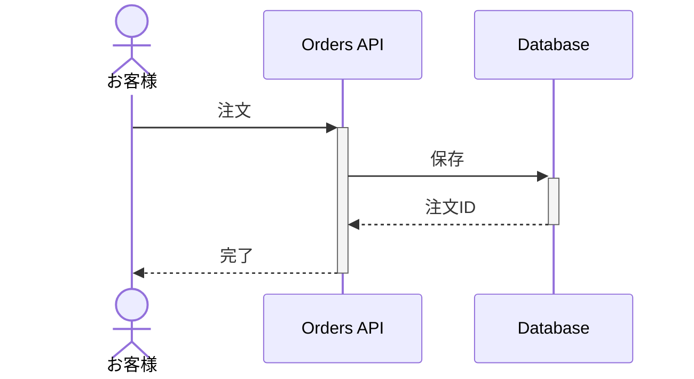

`participant`、`actor`、`as`、`participant A@{ "type": "boundary" }` などの標準タイプ属性（boundary/control/entity/database/collections/queue）、`activate`、`deactivate`、メッセージの `+` / `-` に対応します。参加者はコンパクトに表示し、ラベルは送信元側に寄せます。

矢印は `->>` / `-->>`（塗りつぶし）、`->` / `-->`（矢印なし）、`-)` / `--)`（開いた矢印）、`<<->>` / `<<-->>`（双方向）に対応します。`-x` / `--x`（クロス端点）にも対応し、実線・破線を維持します。`autonumber` と開始番号・増分にも対応します。

半矢印（上下・逆方向・実線／破線）と中央ライフライン接続 `()` にも対応します。中央接続と活性区間は別の指定で、中央接続だけなら `deactivate` は不要です。

```mermaid
sequenceDiagram
  participant API@{ "type": "boundary" }
  participant Worker@{ "type": "control" }
  link API: API資料 @ https://example.com/docs
  properties API: {"owner":"Platform"}
  API-|/Worker: 下半分の矢印
  API->>()Worker: 中央接続
```

`link` / `links` は参加者カード内にリンクとして表示し、`properties` は説明欄に表示します。HTTP(S)・メール・相対リンクを利用でき、実行可能なURLは省略して警告します。SVG保存後もリンクが残ります。ホストページ内の要素を読む `details` には依存せず、図の中へ `properties` / `links` を記述してください。

## 分岐・繰り返し・並列

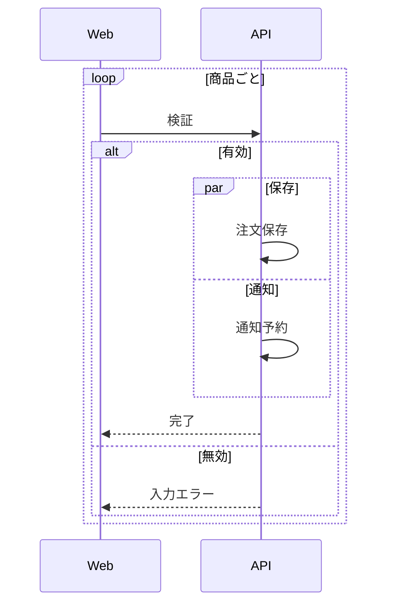

`alt` / `else`、`opt`、`loop`、`par` / `and`、`critical` / `option`、`break`、`rect`、`end` を利用でき、相互に入れ子にできます。`rect` は背景をハイライトします。活性区間は開始と終了を対応させてください。

`Note left of A`、`Note right of A`、`Note over A,B` は対象ライフラインに合わせ、前後のメッセージと重ならない位置に配置します。改行は `<br/>` を使います。`box` は参加者を囲みます。`create participant` / `create actor` は生成メッセージの高さに参加者を置き、`destroy` は破棄時点に×印を付けライフラインを終了します。

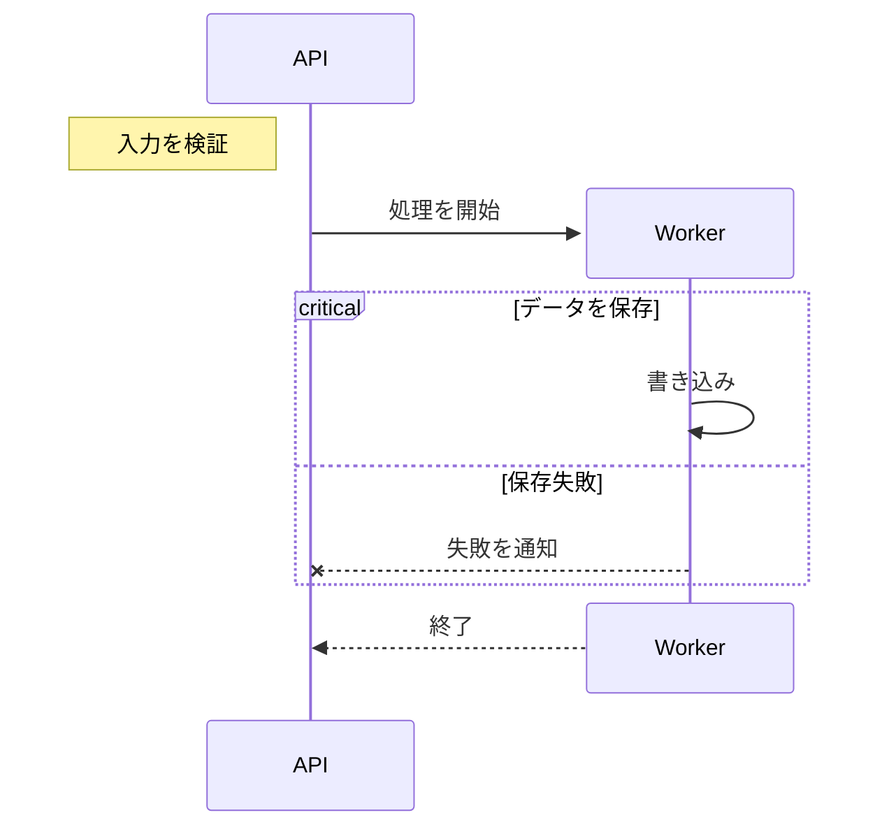

## 画面遷移

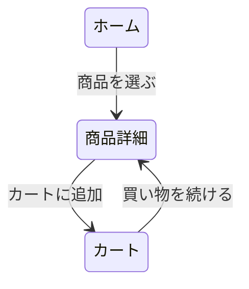

各画面の出力接続をアクション行として表示し、行から線を引きます。複数の遷移もリストに並びます。モーダル・状態変更・遷移しない操作は以下の補助設定で表現できます。

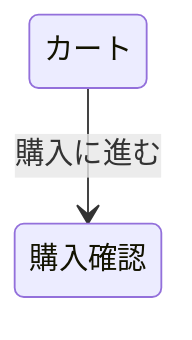

画面間の遷移は必ずMermaidの矢印で記述します。補助設定の actions に遷移先は書きません。`state`、`effect`、`close` は排他的です。`when` に表示上の条件を追加できます。`close: true` はモーダルだけで使用できます。操作名の `label` と所有画面の `node` は必須です。

## 画像付きノード・画面遷移

標準Mermaidの `img` 属性に対応します。独自の画像構文は不要です。通常のflowchartでも利用でき、画面遷移ビューでは画像と操作一覧を1枚のカードに表示します。

```mermaid
flowchart LR
  home@{ img: "https://example.com/home.png", label: "ホーム", pos: "t", h: 240, constraint: "on" }
  detail@{ img: "https://example.com/detail.png", label: "商品詳細", pos: "t", h: 240, constraint: "on" }
  home -->|商品を選ぶ| detail
```

既存の画面遷移表示を使う場合は `%% archmap: {"view":"screens"}` を先頭に指定します。画像の指定そのものは標準構文です。`stateDiagram-v2` に画像構文を追加するものではありません。

`w` / `h` は幅・高さ、`pos` はラベル位置（t=上、b=下）、`constraint: "on"` は元画像の比率を保って高さから幅を求めます。offでは幅と高さを独立に扱います。未指定寸法には読み込んだ画像の寸法を使います。

PNG / JPEG / WebP / GIF / SVGのURLや画像data URLを読み込み、静止画像としてSVGに埋め込みます。これにより書き出したSVG・PNGに画像が残ります。アニメーションは保持しません。外部URLには画像配信元のCORS許可が必要です。読込失敗時は警告と代替枠を表示します。画像URLを使うと画像配信元への通信が発生します。オフラインで使う場合はdata URLを使ってください。

ブラウザーAPIの `renderMermaid` は画像読込と埋め込みまで行います。低レベルの同期 `renderDiagram` を直接使う場合は、先に `await prepareDiagramImages(model)` を呼んでください。

## 業務フロー（BPMN風の担当レーン）

先頭行に `%% archmap: {"view":"bpmn"}` を置き、その下を標準Mermaidの flowchart / graph で記述します。先頭の補助設定の直後にタイトル用frontmatterを置くこともできます。

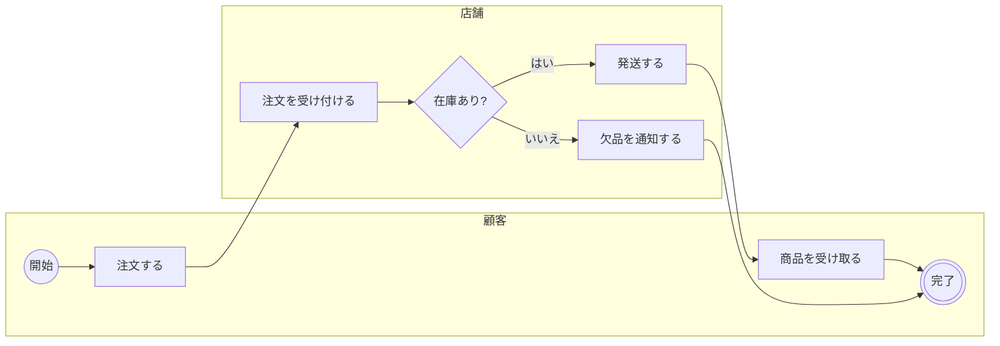

| Mermaidの記述 | このビューでの表示 |
|---|---|
| `subgraph ID[担当名]` | 担当レーン。宣言順に配置し、処理方向の長さをそろえる |
| `A[処理]` / `A(処理)` / `A([処理])` | 角丸の処理ボックス |
| `A((開始))` | 細い円の開始イベント |
| `A(((終了)))` | 太い円の終了イベント |
| `A{条件}` | ひし形の分岐。分岐条件は線のラベルへ |
| `A --> B` | 処理の順序を表す実線・塗りつぶし矢印 |

LR / RLは横方向に進む水平レーン、TB / TD / BTは縦方向に進む垂直レーンです。空レーンも残し、レーン外のノードは最後の帯域に枠なしで配置します。分岐や戻り線は削除しません。色指定は `style` / `classDef` が使えます。

このビューは1つの業務を担当別に読むためのBPMN風表示であり、BPMN 2.0 XMLの入出力・実行エンジンではありません。プール、境界イベント、タイマー、メッセージイベント、並列ゲートウェイなどの正式なBPMN要素は対象外です。破線等はMermaidとして維持し、メッセージフローなどの意味を推定しない旨を警告します。

初期版ではレーンの入れ子・折りたたみ、レーン自体への接続、手動配置 `at`、上表以外のノード形状はエラーにします。レーン内の `direction` は警告し、図全体の方向を使います。レーンをまたぐ線は処理同士へ接続してください。

## アクティビティと並列分岐

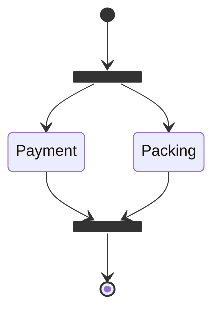

判断ノードに表示名を付ける場合は、`state stock <<choice>>` と `stock : 在庫あり？` を別々の行に書きます。`state "在庫あり？" as stock <<choice>>` と1行にまとめると別IDとして解析されるため使用できません。

開始・終了は `[*]`、判断は `<<choice>>`、並列開始・合流は `<<fork>>` / `<<join>>` を使用します。状態図の複合状態はグループに変換し、内部の `direction` も反映します。同時状態の `--` 区切りは、複合状態内の独立した並行領域として表示します。`note left of STATE: 注記` / `note right of STATE: 注記` と複数行の `note ... end note` に対応し、注記を画面のアクションには含めません。

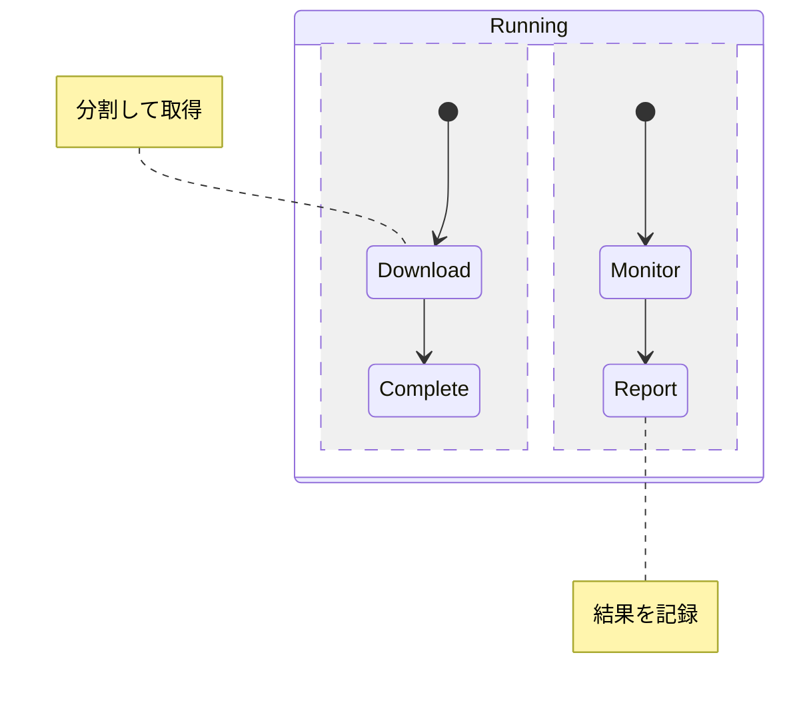

## ER図

`erDiagram` を使います。エンティティは属性表として描き、PK / FK / UK、属性名、型、コメントを分けて表示します。長い属性名・型・コメントは折り返します。属性なしのエンティティ、表示名の別名、nullable型にも対応します。

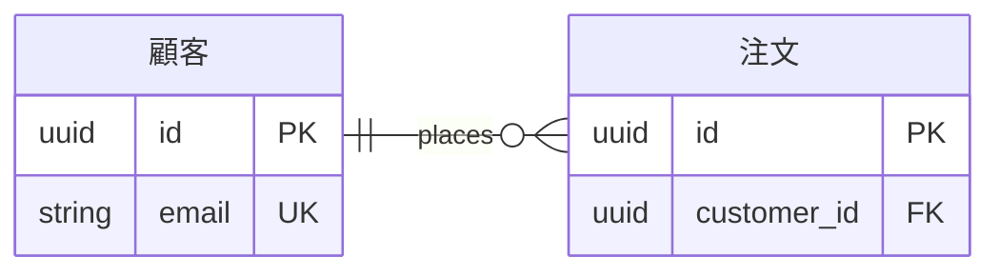

関係の両端にカラスの足記法を表示します。`||`（1）、`o|`（0または1）、`|{`（1以上）、`o{`（0以上）を区別し、識別関係は実線、非識別関係は破線です。線はエンティティへの関係であり、特定の属性への接続を推測しません。`nodes` の補助設定には元のエンティティ名を使います。

## ユースケース図

Mermaid 12の `usecase-beta` を使います。アクターはアイコン付きカード、ユースケースは角丸カプセルまたは矩形、システム境界は淡い背景の枠です。アクターを関連する操作の近くに、include / extend先を別列に配置します。

```mermaid
usecase-beta
  direction LR
  actor Customer(顧客)
  systemBoundary Shop[注文サービス]
    Place(注文する)
    Pay(支払う)
    Coupon(クーポンを適用する)
  end
  Customer -- Place
  Place ..> : include Pay
  Coupon ..> : extend Place
```

関連、向き付き関連、include、extend、汎化（`Admin --|> User`）を区別します。include / extendは破線とラベル、汎化は白抜き三角です。宣言の前方参照、ステレオタイプ、円・クロス端点にも対応します。package境界やアクターの装飾種類はArchMap表示に統一し警告します。注記は `note for Pay "決済完了後に注文を確定"` と書きます。対象に破線で接続した折り返し可能な付箋として表示します。JSONノード、business指定は未対応としてエラーにします。

空のシステム境界も表示します。手動配置と自動配置で境界が重なる場合は、内部の相対位置を保って境界全体をずらします。

ER・ユースケースとも方向はLR / RL / TB / TD / BTです。任意のMermaid装飾や完全互換を保証するものではありません。

## 任意の表示設定

1文書に1ブロックの `%% archmap: JSON` を書けます。1行形式に加え、各行を `%%` で始める複数行JSONに対応します。設定を省略しても標準Mermaidだけで描画できます。

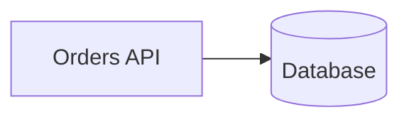

| キー | 値と意味 |
| --- | --- |
| `view` | `system` / `layers` / `screens` / `activity` / `er` / `usecase` / `bpmn` / `overview` / `timeline` / `eventmodeling`。シーケンスは宣言から判定 |
| `style` | `cards`（既定）/ `icons`。アイコン主体表示は system / layers 用 |
| `nodes.ID.icon` | 組み込みアイコン一覧のキー |
| `nodes.ID.description` | 説明の文字列 |
| `nodes.ID.color` | `blue` / `green` / `orange` / `purple` / `gray` |
| `nodes.ID.at` | `[列,行]`。整数1〜400。同じセルの重複不可 |
| `nodes.ID.shape` | `modal`。screensだけで利用可能 |
| `actions` | 画面内操作の配列。上記の画面遷移節を参照 |

グリッドは相対的な順序を指定します。空の行・列は詰めて表示します。シーケンスの参加者順は宣言順、レイヤーはグループの順で決まり、これらでは at は使用しません。

タイトルは標準のfrontmatterを使います。

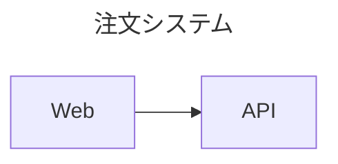

## 背景色・枠線色・文字色

flowchart / graph、stateDiagram-v2、erDiagram のノード・グループは、標準Mermaidの `style` / `classDef` / `class` による `fill`（背景）、`stroke`（枠線）、`color`（文字）を反映します。

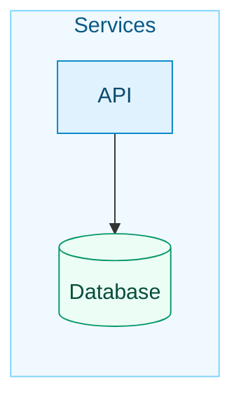

優先順位は `classDef default` → 指定クラス（指定順）→ 個別 `style` です。指定しない色はArchMapの既定色を使用します。HEX・色名・rgb/hsl系の色に対応し、背景と枠線には `none` も使えます。SVG / PNG書き出しにも反映されます。アイコン主体表示では背景・枠線をノードのプレートに適用し、ブランドアイコン自体の配色は保持します。

この指定はノード・グループ用です。キャンバス全体の背景や任意CSSには対応しません。接続線の線幅は下記の `linkStyle` で指定できます。未対応プロパティや外部リソース参照を含む色指定には警告を表示します。

## 未対応と互換性

この版はMermaid完全互換ではありません。`architecture-beta`、クラス図などの他の図種、clickコールバックなどの実行コードは対象外です。`click`操作は現時点ではエラーになります。

`init` / frontmatterの `config` は読み込めます。`sequence.showSequenceNumbers` を反映し、その他のテーマ・レイアウト設定、上記以外のCSS装飾・接続アニメーションは警告を表示して、ArchMapの表示に統一します。Markdownラベルの装飾は文字列として表示します。HTMLラベルを実行せず、外部アイコンを取得しません。構文上正しくても、この対応範囲にない機能は利用できません。

公式仕様: [Flowchart](https://mermaid.js.org/syntax/flowchart.html)、[Sequence](https://mermaid.js.org/syntax/sequenceDiagram.html)、[State](https://mermaid.js.org/syntax/stateDiagram.html)。同じ .mmd を他のMermaid環境でも開けますが、補助設定と描画結果は引き継がれません。

## 配置の縦横比

レンダラーは極端に縦横へ長い図について、方向・文字サイズ・接続を保ったまま余白の異なる候補を比較します。交差や重なりが増える候補は採用しません。目標は幅/高さ1.4の緩い制約で、固定比率ではありません。手動配置・シーケンス・レイヤーや大きな図は従来配置を維持します。長い一本道は自動で折り返さないため、必要なら全体図と詳細図に分けてください。DSLへの追加設定はありません。

## 上限と性能

400ノード、200グループ、1,000接続、1,000画面内操作、グループ8段、フラグメント1,000文・8段、活性区間2,000文・16段、ソース500,000文字までです。文字数はUTF-16コード単位です。線が密な図は処理時間と交差が増えるため、必要に応じてグリッドを調整してください。入力はブラウザー内で解析し、サーバーには送信しません。

## 保存とオフライン利用

エディタの折りたたみ、スワイプ・マウスドラッグによる移動、2本指ピンチ・ホイールズーム、Fit、SVG / PNG / .mmd保存に対応します。下書きはこのブラウザーに保存します。

オフライン版は、パーサー・レンダラー・アイコン・構文リファレンス・AIプロンプトを含む単一HTMLです。ダウンロード後はネット接続なしで開けます。アイコン一覧も全件をUTF-8テキストで保存できます。

## Subgraphのグリッド配置（system）

最上位と各subgraph内で、直下の要素を行優先・左上詰めで配置できます。ノードと接続は標準Mermaidに書き、配置だけをコメントで指定します。

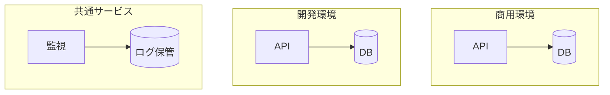

- `columns`：グリッドの列数（1〜20）。
- `items`：配置順。その階層の直下にあるノード・subgraphのIDを全て1回ずつ指定します。孫を直接指定することはできません。宣言順には依存しません。
- `colSpan`：占有列数（既定1、columns以下）。`rowSpan`：占有行数（既定1、1〜20）。`colSpan:2` は横2セル、`rowSpan:2` は縦2セルを結合します。
- 各itemが収まる空き領域を上から左から探します。後のitemが先のitemの横の空きに入る場合があります。
- `sizing`：既定は `content`。各列・行の必要寸法からサイズを決めます。同じ列の左右端、同じ行の上下端は揃います。`equal` は全列・全行のサイズを均等化します。内容は左上に寄せ、ノードや文字を縮小しません。内部の `direction`、入れ子、接続は維持します。
- 対象は `system`。グリッドにはノードとsubgraphを混在できます。`nodes.*.at` とは併用できません。行列の名前は自動推定しないため、subgraph名などに環境・サービス名を記述してください。
- セル結合は配置上の指定であり、サービスの共有や接続を意味しません。線が多い場合の交差を完全に防ぐ指定でもありません。

例：[3環境×4サービス](diagrams/group-grid/environment-matrix.mmd)、[横結合](diagrams/group-grid/horizontal-span.mmd)、[縦結合](diagrams/group-grid/vertical-span.mmd)。

### 階層ごとの指定

`grid` は文書直下、`groups.<ID>.grid` はそのsubgraphの直下の配置です。各階層で列数・セル結合・sizingを変えられます。グリッドを持つ親ではグリッドが子の並べ方を決め、子の内部方向には子自身の `direction` が適用されます。グリッドを持たない入れ子ではLR / RL / TB / BTと接続に従って配置します。

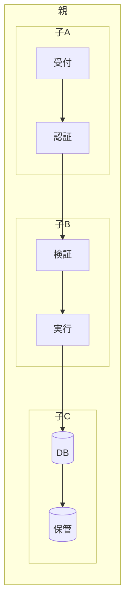

子から必要寸法を計算し、親は子を一つの箱として配置します。深い入れ子の寸法を全ノードの間隔へ一律に加算しません。システム図の入れ子・グリッドに適用し、手動at指定や他の図種固有の配置は維持します。折りたたんだsubgraphの内部配置は展開時に適用します。

例：[親に子3つ・孫グリッド・階層横断接続](diagrams/group-grid/nested-three-children.mmd)、[6階層の方向切替](diagrams/group-grid/nested-directions.mmd)。


## システム概要図（overview）

標準 `flowchart` に `%% archmap: {"view":"overview"}` を付ける。経営・業務向けに名称を24px、対象に付随する吹き出しを22pxで描画する。接続・ノードを自動削除しない。概略の要素選定は著者が行い、技術詳細は別図へ分ける。

`nodes.<ID>.emphasis` は `new`（新規）/ `changed`（変更）/ `impact`（影響あり）/ `unchanged`（変更なし）。色と文字で区別する。`callout` は空でない300文字以下のプレーンテキスト。どちらもoverview専用。`description`、アイコン、画像、style/classによる色、入れ子・gridを併用できる。吹き出しはカードの下部に配置領域を確保するため、対象との対応が曖昧にならない。ノードの形状は概略カードへ統一する。`style:icons`はこのモードでは使わない。

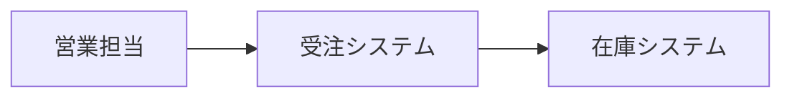

## 時系列

Mermaid **12.3.0（安定版）** と公式 `@mermaid-js/parser` を使用する。13系alphaの描画APIには依存しない。

### Timeline

標準 `timeline`、`title`、`section`、`期間 : イベント : イベント` と次行の `: イベント` に対応。期間は自由な文字列。入力順の縦型年表で表示し、日付を自動ソートしない。期間の長さに比例する時間軸ではない。`direction`やMermaid独自テーマはArchMapの表示へ反映しない。空のsectionは描画しない。

```mermaid
timeline
  title 導入計画
  section 試行
    2026年11月 : 影響範囲を確認 : 検証環境を準備
  section 展開
    2027年1月 : 先行運用
    2027年2月 : 全拠点へ展開
```

### Event Modeling

標準 `eventmodeling` の `tf` / `timeframe`、`rf` / `resetframe`、`ui`・`pcr/processor`・`cmd/command`・`rmo/readmodel`・`evt/event`、名前空間、inline data、`data`参照、`->>` の複数参照に対応。公式パーサーで解析し、ArchMapのレーンと時間順の列で表示する。フレーム番号は識別子であり、数値順には並べ替えない。同じ要素の再登場は別フレームとして残す。

明示参照がない通常フレームは、手前の異なる推論レーンのフレームから関連を推論する。12.3.0の挙動に合わせ、2要素の名前空間付きフレームはそれぞれ独立の推論レーンとして扱う。表示レーンをまとめてもこの関連は変えない。resetは推論を止める。`->>` は指定フレームから現在のフレームへの入力。注釈を接続として捏造しない。独立したnote / GWT / entity定義・data型指定は未対応としてエラーにする。日付・経過時間の数値軸ではない。長いフローは関連を保って複数図へ分ける。`nodes.at`、gridは使用できない。

```mermaid
eventmodeling
  tf 01 ui Cart
  tf 02 cmd AddItem { productId: string }
  tf 03 evt ItemAdded
  tf 04 rmo CartItems ->> 03
  tf 05 ui Cart
```

GanttとXY Chartは今回の追加範囲に含めない。年表・情報の変化・数値推移を同じ図種として扱わない。


## 直線接続と線幅

flowchart を使う図（概略図を含む）では、折れ点のない接続を選べます。

```mermaid
%% archmap: {"view":"overview","routing":"straight","edges":{"1":{"routing":"orthogonal"}}}
flowchart LR
  A[利用者] --> B[業務サービス]
  B --> C[データベース]
  linkStyle default stroke-width:3px
  linkStyle 0 stroke-width:6px
```

- `routing: "straight"`: ノードの中心を結ぶ方向で、外周から外周へ直線接続。既定値は `orthogonal`（直角配線）。
- `edges` は入力順の0始まり接続番号ごとの表示設定。全体指定より個別指定を優先します。
- 標準Mermaidの `linkStyle default stroke-width:3px` と `linkStyle 0,2 stroke-width:5px` に対応。個別指定が既定指定より優先されます。0.5〜16px、小数・px省略可。SVGとPNGに反映します。
- 直線は障害物を迂回しません。交差がある場合は警告を確認し、`nodes.<id>.at` で配置するか、その線だけ `orthogonal` にしてください。自己ループや重なる接続先は通常経路に戻し、警告します。
- 概略図はカード外周（吹き出しを除く）、通常図は矩形・円・ひし形の外周を基準にします。その他の形状は外接矩形を基準にします。
- `linkStyle` の stroke / stroke-width 以外のCSS、Mermaidの曲線指定による直線化は未対応です。通常線1.8px、太線 `==>` 3.2pxが未指定時の太さです。

## 概略図の吹き出しと矢印の色

```mermaid
%% archmap: {"view":"overview","nodes":{"A":{"callout":"入力元は変更なし","calloutSize":"h5"},"B":{"callout":"処理を自動化","calloutSize":"h2"}},"edges":{"0":{"callout":"手作業を削減","calloutSize":26}}}
flowchart LR
  A[業務担当] --> B[受注サービス]
  linkStyle default stroke:#64748b,stroke-width:3px
  linkStyle 0 stroke:#d65a23,stroke-width:5px
```

- `linkStyle` の `stroke` は線と矢印先端を同じ色にします。全flowchartビューで有効。個別指定は default より優先します。外部URL・CSS変数は受け付けません。
- 概略図（`view:"overview"`）の `nodes.<ID>.callout` で、起点・終点を含む任意のコンポーネントに吹き出しを付けます。
- `edges.<0始まり接続番号>.callout` で線に説明を付けます。線の長い区間の中点を指す引出線付きの吹き出しです。通常の接続ラベルと併用できます。
- `calloutSize` は12〜48の数値（px）、または `h1`=36、`h2`=30、`h3`=26、`h4`=22、`h5`=18、`h6`=16。省略時22px。見た目のサイズ指定でありHTML見出しではありません。
- 吹き出し本文は1〜300文字のプレーンテキスト。長文は指定サイズで折り返し、高さを確保します。SVGとPNGで共通です。
- 線の吹き出しは近傍の空き領域に配置し、空きがなければ図の右側へ広げます。密な図では引出線が交差することがあるため、配置確認が必要です。

## 概略図で主役と周辺情報を分ける

`view:"overview"` の nodes / edges に `attention` を指定すると、図全体に強調の階層を適用します。

```mermaid
%% archmap: {"view":"overview","nodes":{"PC":{"attention":"problem","callout":"不正利用PCの通信を遮断"},"Guard":{"attention":"focus","callout":"検知・判定・通信制御"}},"edges":{"1":{"attention":"focus"},"2":{"attention":"problem"}}}
flowchart LR
  LAN[社内LAN] --- PC[利用者PC]
  PC -->|操作ログ| Guard[監視システム]
  Guard -->|通信遮断| PC
```

| attention | 表現 |
| --- | --- |
| context | 周辺情報。無彩色、細い枠・線、20pxの見出し、小さなアイコン、既定16pxの吹き出し |
| focus | 説明の主役。深緑、太い枠、26pxの見出し、既定24pxの吹き出し |
| problem | 問題・影響箇所。赤、太い枠・接続線、26pxの見出し、既定28pxの吹き出し |

1要素でも attention があれば、未指定のノード・接続線とグループは周辺情報として無彩色にします。画像・多色アイコンも周辺ではグレースケール表示します。要素・本文・関係は削除せず、透明度で文字を読みにくくしません。

このモードでは attention の配色・枠幅・線幅を style / linkStyle より優先します。元の色指定はモデルに保持します。calloutSize の明示指定は優先します。attention を全て外すと通常の配色に戻ります。新規・変更などの意味を持つ emphasis とは独立した表示設定です。focus や problem は作者が指定し、接続相手へ自動伝播させません。

### 主役だけ書体を変える

overview の `nodes.<ID>.fontFamily` に `sans`（ゴシック）、`serif`（明朝）、`mono`（等幅）を指定できます。attention が focus または problem のノードの見出し・吹き出しにだけ反映します。本文・周辺情報は共通書体のままです。

例：`"nodes":{"Guard":{"attention":"focus","fontFamily":"serif","callout":"検知から遮断まで"}}`。
未指定は通常書体。context に切り替えると書体変更も無効になります。サイズ・色の強調は従来どおり併用できます。字幅の違いを見込んで折り返し、高さを確保します。
フォントファイルは外部取得せず端末内のフォントへフォールバックするため、端末間で厳密に同一の字形は保証しません。SVG / PNGへ指定を反映します。

### 複数行の表示設定とタイトル

```mermaid
---
title: 監視と通信遮断のシステム概要
---
%% archmap: {
%%   "view": "overview",
%%   "nodes": {
%%     "Guard": {
%%       "attention": "focus",
%%       "fontFamily": "serif",
%%       "callout": "検知から遮断まで"
%%     }
%%   }
%% }
flowchart LR
  PC[利用者PC] --> Guard[監視システム]
```

開始行は `%% archmap: {`、続くJSONの全行に `%%` を付け、`%% }` で閉じます。標準JSONなので末尾カンマやJSON内コメントは使えません。1文書に設定ブロックは1つ。従来の1行形式も有効です。プレイグラウンドのカード／アイコン切り替えでも複数行形式を保持します。

タイトルは標準MermaidのYAML frontmatter（先頭の `---`）に `title:` で指定します。archmapブロックをfrontmatterの前に置いても解析できます。図の上部に表示し、長いタイトルは折り返して領域を確保します。複数行タイトルはYAMLの `title: |` が使用できます。`archmap.title` は設定項目ではありません。
